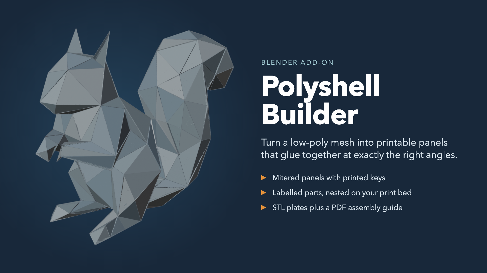

# Polyshell Builder

A Blender add-on that turns a closed low-poly mesh into flat, printable panels that glue
together at exactly the right angles. Each panel is a mitered shell with printed
alignment keys and raised labels, nested onto print beds and exported as STL plates with
a PDF assembly guide.

- Overview handout: [docs/Polyshell_Builder_Handout.pdf](docs/Polyshell_Builder_Handout.pdf)
- Full documentation and changelog: [polyshell_builder/README.md](polyshell_builder/README.md)

## Install

In Blender 4.5 or newer, open **Edit > Preferences > Get Extensions** and search for
**Polyshell Builder**, or download the zip from the
[Releases](../../releases) page and use **Install from Disk**. Then open the 3D View
sidebar (N) and choose the **Polyshell** tab.

## Reporting a problem

Open an [issue](../../issues) and include:

- your Blender version,
- the text of the **Polyshell Report** (Text Editor) or `polyshell_report.txt`,
- if you can, the .blend file or the source mesh.

## License

GNU General Public License v3.0 or later. Copyright 2026 Christian Faur.
